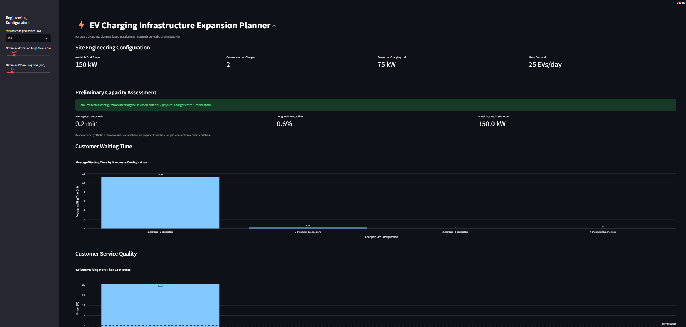

# EV Charging Infrastructure Intelligence & Expansion Planner

### Python | SQL | Machine Learning | Charging Simulation | Streamlit

## Project Overview

An engineering decision-support prototype designed to analyze electric vehicle charging behavior, forecast charging-session demand, and evaluate charging infrastructure expansion scenarios.

The project combines historical charging data, machine learning, queue simulation, electrical power constraints, and interactive dashboards to support preliminary charging-site planning.

## Application Preview

### EV Charging Infrastructure Expansion Planner

The interactive dashboard helps evaluate:

- Physical charging units and connector requirements
- Customer waiting times and service quality
- Site grid-power limitations
- Charging infrastructure expansion scenarios
- Preliminary capacity recommendations

Results are based on illustrative engineering assumptions
and synthetic charging-demand simulations.

## Engineering Problem

Charge Point Operators (CPOs) must decide:

- How many chargers and connectors does a site need?
- How long will customers wait during busy periods?
- How does grid capacity affect charging performance?
- Is installing additional charging hardware beneficial?
- How sensitive are infrastructure decisions to uncertain demand?

## Key Features

**1. EV Charging Data Analytics**

- SQLite database with over 72,000 imported charging sessions
- Charging behavior analysis across different location categories
- Individual charger performance and session-duration analysis

**2. Demand Forecasting**

- Random Forest regression model
- Seasonal baseline comparison
- Chronological training and testing
- Forecast performance evaluation using Mean Absolute Error (MAE)

**3. Charging-Site Simulation**

- Synthetic vehicle-arrival scenarios informed by research data
- First-come-first-served queue simulation
- Customer waiting-time and connector-occupancy analysis
- Configurable site grid-power limitations
- Physical chargers with multiple power-sharing connectors
- Energy conservation and session-completion checks

**4. Scenario and Uncertainty Analysis**

- Comparison of charging hardware configurations
- Grid-capacity sensitivity analysis
- Monte Carlo simulation across 20 synthetic months
- Evaluation of customer service targets

**5. Interactive Dashboards**

Built using Streamlit and Plotly to visualize charging activity, forecasting results, and preliminary infrastructure expansion assessments.

## Technologies

Python, Pandas, NumPy, SQLite, Scikit-learn, Streamlit, Plotly, Git

## Installation

Clone the repository and open the project folder.

Install the required Python libraries:

`python -m pip install numpy pandas scikit-learn streamlit plotly`

Download `ChargingRecords.csv` from the research dataset below and save it inside a folder named `data`.

Import the charging records:

`python import_real_sessions.py`

Launch the charging analytics dashboard:

`python -m streamlit run dashboard.py`

To reproduce the latest expansion analysis, run:

`python grid_aware_simulation.py`

Launch the expansion dashboard:

`python -m streamlit run expansion_dashboard.py`

## Data Source

The project uses the publicly available research dataset:

[A dataset for multi-faceted analysis of electric vehicle charging transactions](https://figshare.com/articles/dataset/22495141)

The original source includes charging-session records, timestamps, delivered energy, and charger classifications.

Downloaded datasets and generated databases are excluded from the Git repository.

## Current Results

- Over 72,000 charging sessions imported and analyzed
- Historical session-arrival forecasting with a Random Forest and seasonal baseline
- Simulated waiting times across charger and grid-capacity configurations
- Monte Carlo evaluation of service requirements over 20 synthetic months
- Interactive charging analytics and expansion-planning dashboards

## Engineering Assumptions and Limitations

This is an educational engineering prototype, not a validated commercial site-planning tool.

- The research data is not representative of the German EV charging market.
- Vehicle arrivals used in simulations are synthetic.
- Charger power ratings and cabinet-sharing arrangements are illustrative assumptions.
- The model does not yet account for realistic vehicle charging curves, equipment failures, customer abandonment, or complete infrastructure investment costs.
- The forecasting experiment models aggregated charging-session starts rather than validated individual-site power demand.
- Infrastructure recommendations require additional validation, operational data, and financial assessment.

## Future Development

- Configurable hardware and site specifications
- Vehicle-specific DC charging power profiles
- Site-level demand forecasts with uncertainty intervals
- Charger reliability and operational constraints
- German-market infrastructure cost and financial models
- Investment and expansion decision optimization

## Project Purpose

Develop and demonstrate practical capabilities in EV charging infrastructure engineering, applied data analytics, machine learning, simulation, and software-based decision support.